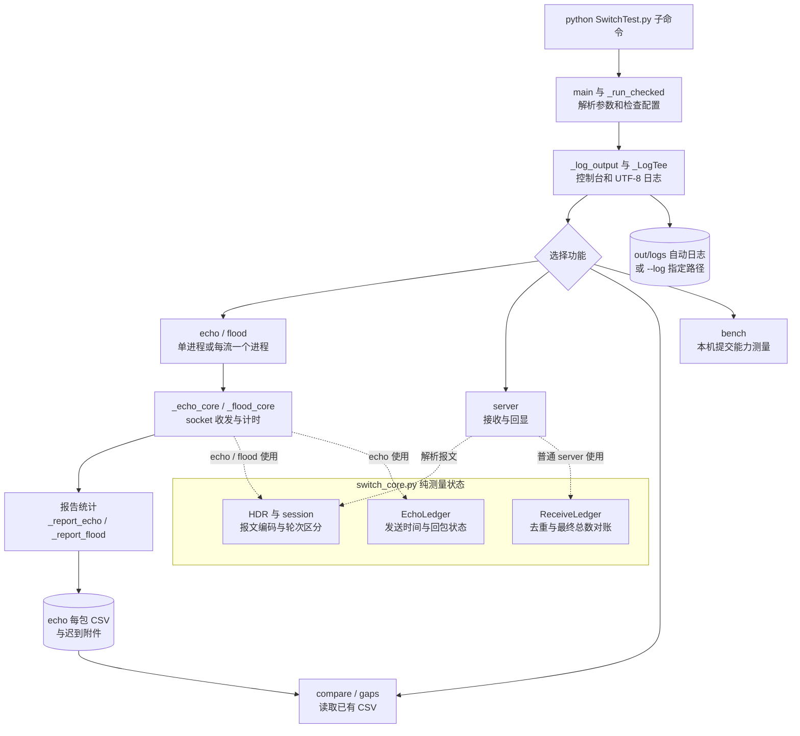
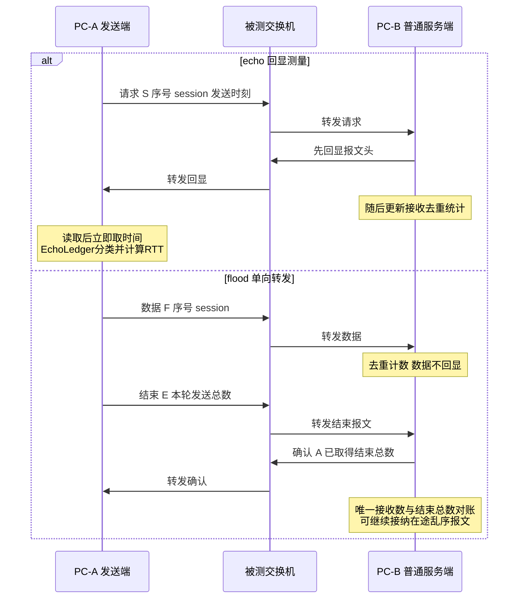
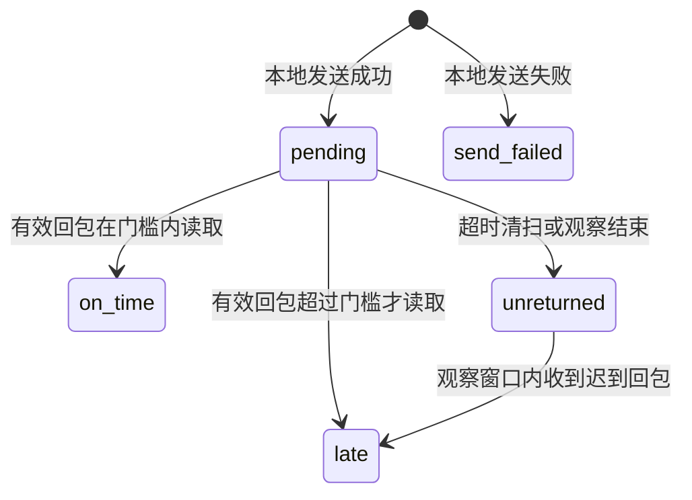

# 交换机测试程序架构说明

更新日期：2026年10月13日。

## 文件职责

| 文件 | 职责 | 现场测试是否需要复制 |
| --- | --- | --- |
| SwitchTest.py | 命令行、参数校验、网络收发、多进程、结果统计、CSV与自动日志 | 是 |
| switch_core.py | 报文格式、测试轮次标识、EchoLedger超时状态、ReceiveLedger接收去重 | 是 |
| test_switch.py | 测量状态、UDP回环、进程崩溃、Windows多进程回归测试 | 开发验证时需要 |
| test_logging.py | UTF-8日志、中文路径、控制台与错误输出、防覆盖、禁用日志测试 | 开发验证时需要 |
| README.md | 快速用法与指标定义 | 参考材料 |
| 国产交换机短时测试操作规程.md | 接线、端口覆盖、命令、记录表与高负荷步骤 | 操作参考 |
| 短时测试判据建议.md | 尚待正式约定的判读建议 | 判读参考 |
| 需求对照核查.md | 历史需求、版本差异与已发现的文档问题 | 项目追溯 |
| 程序架构说明.md | 本架构图与代码阅读入口 | 理解代码时参考 |

run_logged.py已删除，其功能由主程序自动日志替代。NetCheck.py已删除，原为未使用的独立辅助脚本，不是主程序依赖。日志和CSV不是缓存，不应作为无用文件删除。Python运行时生成的__pycache__可再生成；.idea属于IDE配置，不参与测试收发。

## 模块与执行关系

实线表示执行或结果流向，虚线表示对核心模块的使用。网络I/O和日志在SwitchTest.py中，核心账本不直接操作socket或日志。bench发送基准报文，不使用echo的超时账本。flood不生成每包CSV，结果保存在两端报告与日志。

## 两台电脑之间的数据流

echo的按时、迟到和未回包主要在发送端统计；flood的唯一接收数和缺口在接收端统计。结束确认不证明所有数据包均已到达。server --fast只回显，不使用接收去重账本，也不确认flood结束总数。

## 回包状态

late仍属于超时失败，完整RTT另记，不能回填为按时成功。观察结束后仍未回包仅代表有限窗口内未读取到。重复、轮次不匹配或发送时刻不匹配的回包不能改变既有结果。

## 多进程和日志

默认单流在父进程直接执行；-j大于1时通过spawn启动独立流，每流有自己的socket和session，结果经Queue交给父进程。_collect_workers负责汇总并检测未返回结果的异常退出。流编号不会按完成顺序重编。

主进程和工作进程使用追加方式写同一个UTF-8日志，控制台继续显示进度。日志默认在out/logs；--log指定文件；--no-log禁用。每秒进度不是逐包打印。CSV由发送端汇总后写入，参数和启动时间另可从本轮日志核对。

## 代码阅读顺序

1. main和_run_checked：看命令分派、自动日志与参数校验。
2. _echo_core与EchoLedger：看正式发包、统一截止时间、收尾观察。
3. cmd_server与ReceiveLedger：看先回显、去重和结束总数处理。
4. _flood_core与_finish_stream：看目标速率、单向提交和结束确认。
5. _report_echo、_report_flood、load_csv：看结果输出与离线分析。

独立自动验收工具、p50/p90基线倍率和多口同时满载仍未实现，不应在架构图中视为已有模块。
